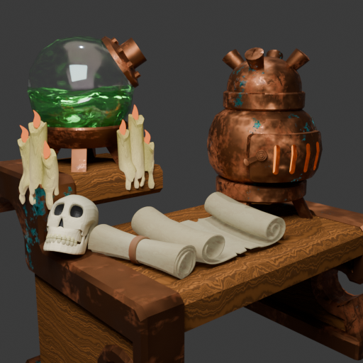
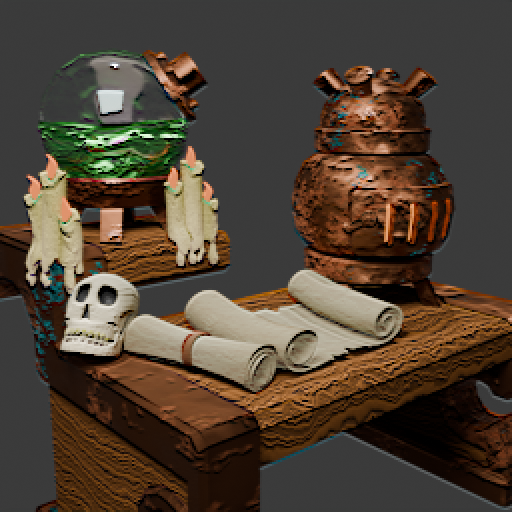
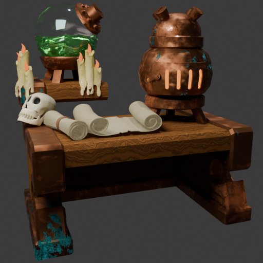
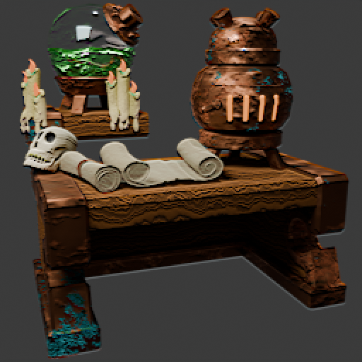
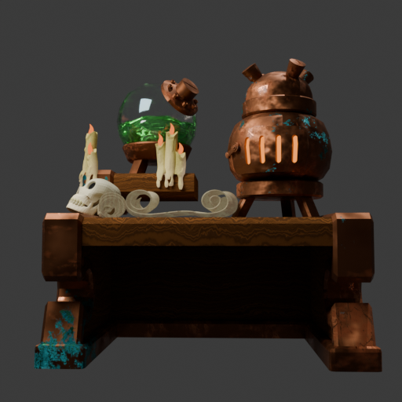

# Алхимическая печь

**Стилизованная сцена в Blender: медная печь, колба с зельем, череп, свечи и свитки на старом верстаке.**

  

## Рендеры

Три ракурса, у каждого два варианта.

<table>
<tr>
<td align="center"> Крупный план</td>
<td align="center"> Крупный план, вариант</td>
</tr>
<tr>
<td align="center"> Три четверти</td>
<td align="center"> Три четверти, вариант</td>
</tr>
<tr>
<td align="center"> Анфас</td>
<td align="center"> Анфас, вариант</td>
</tr>
</table>

## Что в сцене

| | |
|---|---|
| **Объекты** | медная печка с окошками, стеклянная колба с жидкостью на подставке, череп, три свечи с фитилями, свитки пергамента, верстак и полка |
| **Геометрия** | около 38,7 тыс. треугольников; Subdivision, Solidify, Mirror и Geometry Nodes |
| **Свитки** | NURBS-кривые |
| **Материалы** | медь с патиной, воск, пергамент, стекло, жидкость, дерево. Процедурные, на Noise, Wave и Voronoi |
| **Свет** | Sun + Area, светящиеся окошки печки и пламя свечей (Emission) |
| **Рендер** | Cycles, 512 × 512 |

## Файл сцены

Исходный `.blend` весит около 270 МБ, поэтому лежит не в репозитории, а в [релизе](../../releases/latest) zip-архивом (~42 МБ).

Сохранён в Blender 5.0 (предрелизная сборка 4.5.90), открывается в 5.0 и новее. Текстура грязи (`grunge_14.png`) упакована внутрь файла. Текстура печки (`текстура печки 2.png`) в файл не упакована: без неё Blender покажет печку розовой.
